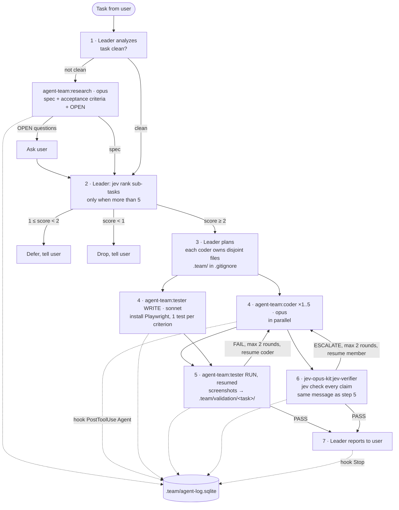

# How it works




## Steps

| Step | Who | Model | In | Out |
|---|---|---|---|---|
| 1 Analyze | Leader | fable / opus | task | clean or not |
| 1b Research | `agent-team:research` | opus | task + ambiguities | spec, acceptance criteria, OPEN questions |
| 2 Rank | Leader runs `jev rank`, only when more than 5 sub-tasks | CLI | goal + sub-tasks | score 0..3, confidence |
| 3 Plan | Leader | | sub-tasks with score ≥ 2 | table: Rank, Agent, Files owned, Brief |
| 4 Send | `agent-team:coder` ×1..5 (effort medium), `agent-team:tester` WRITE (effort medium) | opus, sonnet | brief with `path:start-end` and an example to copy | diff + check; test file |
| 5 Run | `agent-team:tester` RUN, resumed with SendMessage | sonnet | task name | PASS/FAIL, screenshot paths |
| 6 Check | `jev-opus-kit:jev-verifier`, sent in the same message as step 5 | plugin | coder reports + criteria | PASS, or ESCALATE with flagged claims |
| 7 Report | Leader | | | files, tests, screenshot folder, Jev verdict |

## Thresholds

- `jev rank`: score ≥ 2 goes now, 1 to under 2 is deferred, under 1 is dropped. Confidence under 0.6: the Leader decides.
- `jev check`: unsupported ≥ 0.7 FLAG, 0.35 to 0.7 UNCERTAIN, under 0.35 OK. Any FLAG means ESCALATE.
- Test-fix loop and ESCALATE loop: at most 2 rounds each, then stop and report to the user.

## Hooks and log

| Hook | When | Writes |
|---|---|---|
| `SessionStart` | session opens | injects `rules/LEADER.md` into context |
| `PreToolUse` matcher `Agent` | the Leader sends a brief | `description = start`, `tool_use_id` |
| `PostToolUse` matcher `Agent` | a member reports | `agent`, `description`, `prompt` is the brief, `response` is the report, `tool_use_id` |
| `Stop` | Leader ends a turn | `agent = leader`, `response` is the final message |

Table `runs(id, ts, session_id, agent, description, prompt, response, tool_use_id)` in the project's `.team/agent-log.sqlite`. The view `durations` joins each report to its start row and gives `seconds` per member call:

```bash
sqlite3 .team/agent-log.sqlite "select agent, description, seconds from durations order by seconds desc"
```
